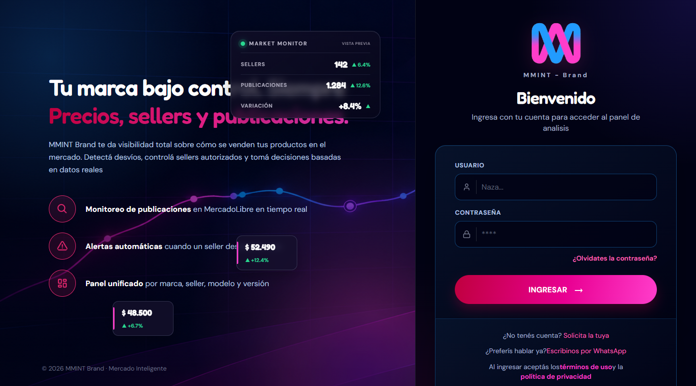
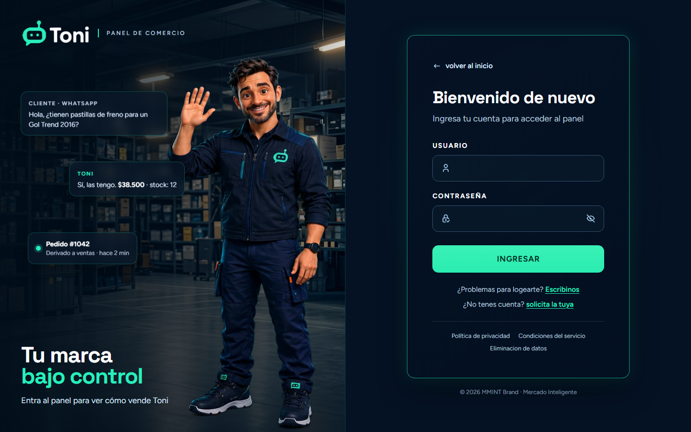
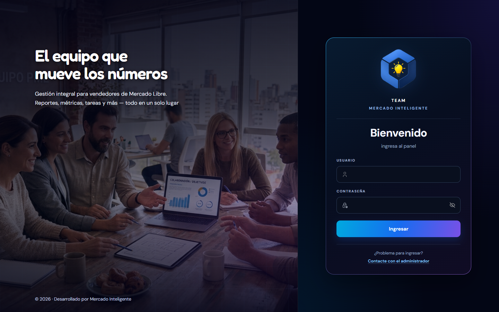

# LOGINS-REACT

Colección de **pantallas de login** hechas con **React 19** y **Vite**. Cada carpeta es un proyecto independiente, con su propio diseño, su propio README y capturas. Son solo el frontend: no hay backend ni autenticación real.

## Resumen

| Proyecto | Para qué es | Lo más destacado | Stack |
| --- | --- | --- | --- |
| [**MMINT Brand**](login-react-mmint-brand) | Panel de análisis de precios y sellers en MercadoLibre | Login, solicitud de cuenta, restablecer contraseña y modales legales con **React Router** | React, Vite, React Router, CSS |
| [**Toni**](login-react-toni-chat) | Panel de comercio de un asistente de WhatsApp | Portada con tarjetas flotantes animadas, responsive de 320 px a 2560 px | React, Vite, CSS |
| [**MMINT Vault**](login-react-vault) | Gestor de contraseñas de un equipo | Mostrar u ocultar contraseña, validación de campos, adaptado a PC, tablet y celular | React, Vite, CSS |
| [**Dash (Team Mercado Inteligente)**](login-react-dash-mmint) | Panel de gestión para vendedores de Mercado Libre | Mismo sistema de diseño oscuro, validación en orden usuario → contraseña | React, Vite, CSS |

## Vista previa

| MMINT Brand | Toni |
| :---: | :---: |
|  |  |
| **MMINT Vault** | **Dash** |
|  |  |

## Qué tienen en común

- **Formularios controlados** con `useState` y validación de campos con mensajes de error.
- **Responsive**: escritorio, tablet y celular.
- **CSS propio**, sin librerías de UI, con un archivo de estilos por pantalla.
- **Componentes chicos** y separados por responsabilidad.
- **Documentados**: cada proyecto tiene README con capturas, cómo correrlo y estructura.

## Cómo probar uno

Necesitás [Node.js](https://nodejs.org) 18 o superior. Elegí la carpeta del login que quieras ver:

```bash
git clone https://github.com/nazareno11414/LOGINS-REACT.git
cd LOGINS-REACT/login-react-mmint-brand
npm install
npm run dev
```

Los usuarios de prueba de cada login están en el README de su carpeta.
