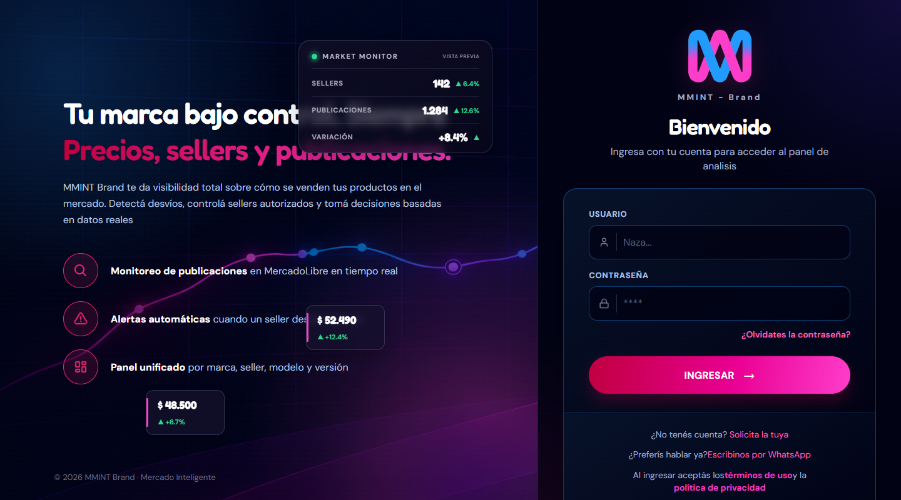
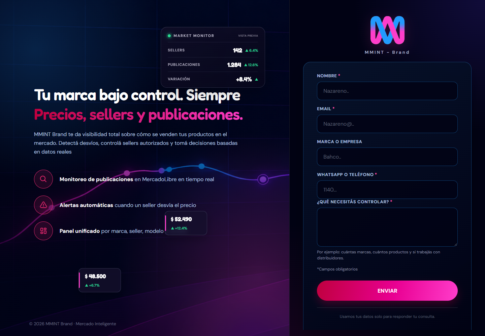
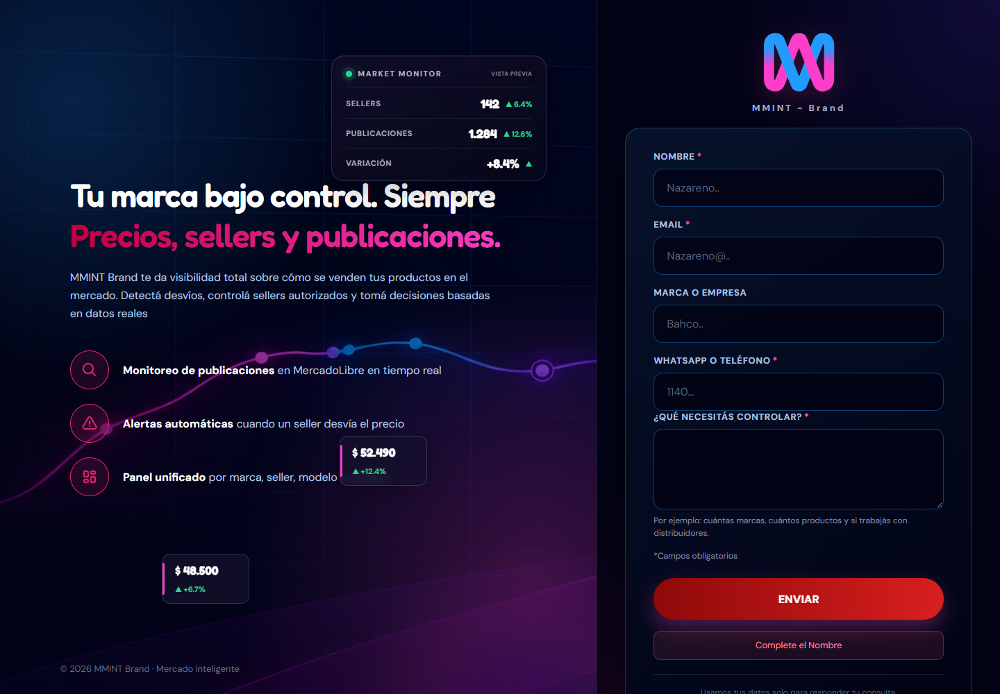
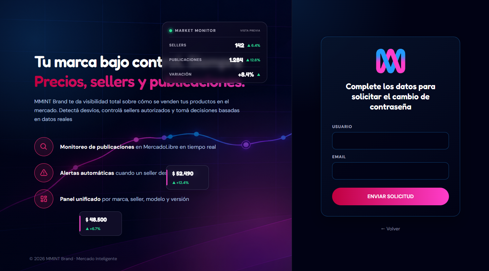
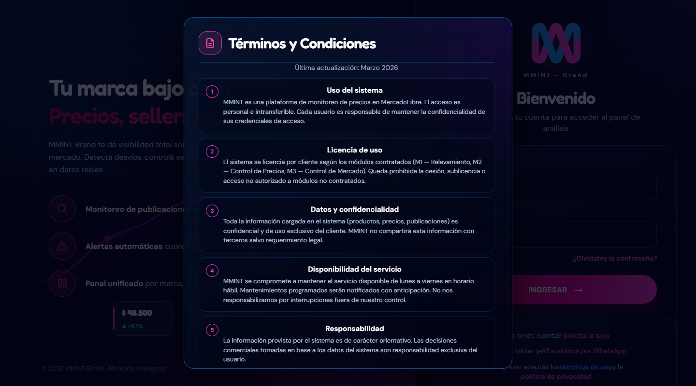
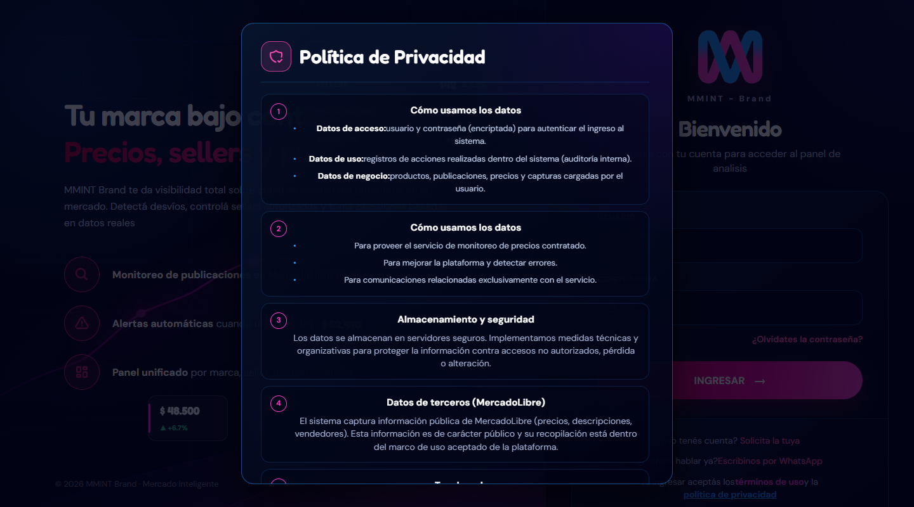
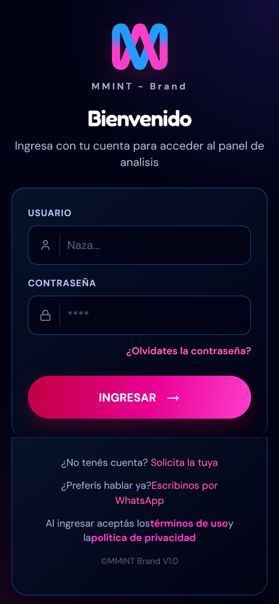

# MMINT Brand · Login

Pantalla de acceso para **MMINT Brand**, un panel de análisis para monitorear precios, sellers y publicaciones de una marca en MercadoLibre. Hecha con **React 19**, **Vite** y **React Router**, con un diseño oscuro con acentos magenta/azul y responsive.



## Qué incluye

- **Login** con usuario y contraseña, validado contra una lista de usuarios de prueba.
- **Solicitud de cuenta** (`/registro`): formulario con nombre, email, marca o empresa, WhatsApp y motivo. Valida los campos obligatorios y avisa cuál falta.
- **Restablecer contraseña** (`/restablecerpassword`): pide usuario y email para enviar la solicitud.
- **Términos y condiciones** y **política de privacidad** como ventanas modales, sin salir del login.
- **Panel de presentación** a la izquierda, con vista previa del "Market Monitor", gráfico animado y tarjetas flotantes.
- **Contacto directo por WhatsApp** desde el pie del formulario.
- **Responsive**: en celular se oculta el panel de presentación y queda solo el formulario.

## Capturas

### Solicitar cuenta

Formulario de alta con campos obligatorios marcados y mensaje de error si falta alguno.




### Restablecer contraseña



### Términos y política de privacidad

| Términos y condiciones | Política de privacidad |
| :---: | :---: |
|  |  |

### Versión móvil



## Tecnologías

| Herramienta | Uso |
| --- | --- |
| [React 19](https://react.dev) | Interfaz y estado de los formularios |
| [React Router 7](https://reactrouter.com) | Rutas: login, registro y restablecer contraseña |
| [Vite](https://vite.dev) | Servidor de desarrollo y build |
| CSS puro | Estilos separados por pantalla, sin librerías de UI |
| ESLint | Reglas de React y React Hooks |

## Cómo probarlo

Necesitás [Node.js](https://nodejs.org) 18 o superior.

```bash
git clone https://github.com/nazareno11414/LOGINS-REACT.git
cd LOGINS-REACT
npm install
npm run dev
```

Abrí la dirección que muestra la terminal (normalmente `http://localhost:5173`).

### Usuarios de prueba

| Usuario | Contraseña |
| --- | --- |
| `user` | `user` |
| `123` | `123` |

> Es una demo del frontend: no hay servidor ni base de datos. Los usuarios están en `src/usuariosprueba/prueba.jsx` y los formularios de registro y restablecer contraseña validan los datos pero no envían nada a ningún lado.

## Scripts

| Comando | Qué hace |
| --- | --- |
| `npm run dev` | Levanta el servidor de desarrollo |
| `npm run build` | Genera la versión de producción en `dist/` |
| `npm run preview` | Sirve el build para probarlo |
| `npm run lint` | Revisa el código con ESLint |

## Estructura

```
src/
├── Login.jsx                  # Layout (panel izquierdo + derecho) y rutas
├── main.jsx                   # Punto de entrada con BrowserRouter
├── pages/
│   ├── PageLeft.jsx           # Panel de presentación
│   ├── PageRightForm.jsx      # Formulario de login
│   ├── PageRegistro.jsx       # Solicitud de cuenta
│   ├── PageResetPassword.jsx  # Restablecer contraseña
│   ├── PageTerminosYCondiciones.jsx
│   └── PagePrivacidad.jsx
├── styles/                    # Un CSS por pantalla
├── image/                     # Logo, fondo e íconos
└── usuariosprueba/            # Usuarios de demostración
docs/                          # Capturas usadas en este README
```
