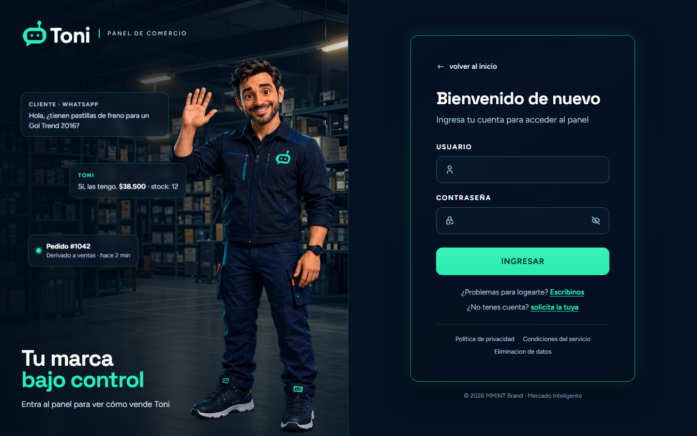
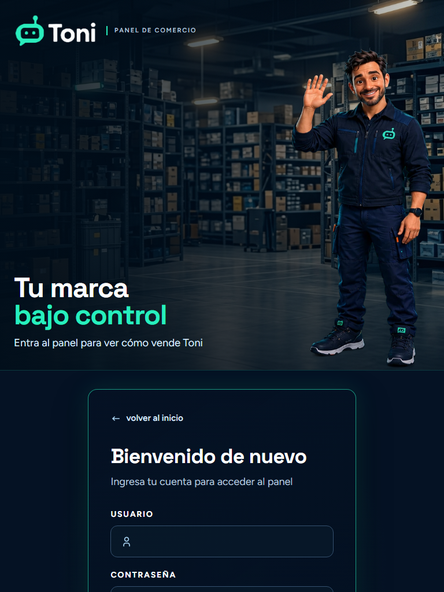
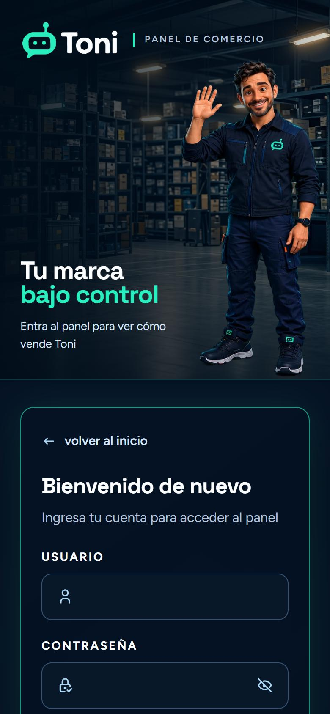
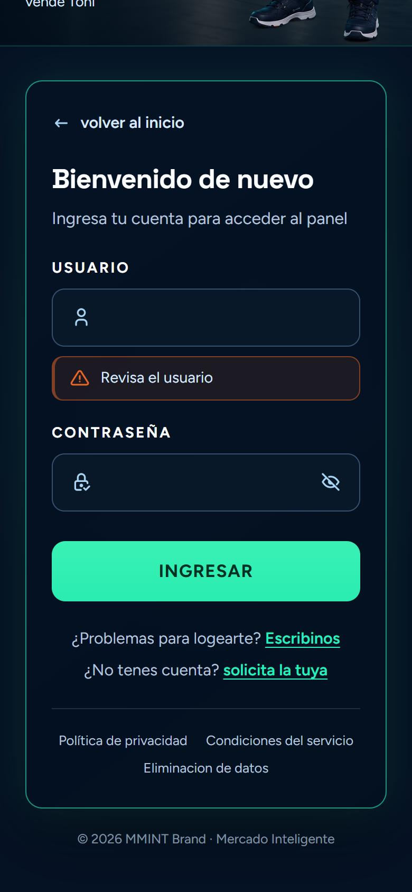

# Toni · Login del Panel de comercio

Pantalla de acceso al **Panel de comercio de Toni**, el asistente que atiende las consultas de un comercio por WhatsApp. Hecha con **React 19** y **Vite**, con un diseño oscuro de acento menta y totalmente responsive: de un celular de 320 px a un monitor de 2560 px.



## Qué incluye

- **Formulario de acceso** con usuario y contraseña, y un botón para **mostrar u ocultar la contraseña**.
- **Validación de campos**: si falta el usuario o la contraseña, aparece una tarjeta de error debajo del campo que falló.
- **Portada de marca** a la izquierda: logo, Toni saludando sobre un depósito de repuestos, titular y tres **tarjetas flotantes animadas** que simulan una consulta real (mensaje del cliente, respuesta de Toni y pedido derivado a ventas).
- **Enlaces de ayuda**: volver al sitio de Toni, soporte por WhatsApp, pedir una cuenta, y los textos legales (política de privacidad, condiciones del servicio y eliminación de datos).
- **Pie de página** con el copyright de MMINT Brand · Mercado Inteligente.
- **Responsive** con tres composiciones distintas (ver más abajo).
- **Accesible**: contorno visible al navegar con teclado y animaciones reducidas si la persona lo pide en su sistema.

## Capturas

### Tablet

En pantallas de hasta 900 px los dos lados se apilan: la portada arriba y el formulario debajo, ya visible en la primera pantalla.



### Celular



### Validación

Si un campo está vacío, el error aparece justo debajo de él, con el ícono y el color de alerta de la marca.



## Cómo correrlo

Necesitás [Node.js](https://nodejs.org) (se probó con la versión 24).

```bash
npm install
npm run dev
```

Se abre en `http://localhost:5173`.

| Comando | Qué hace |
|---|---|
| `npm run dev` | Servidor de desarrollo con recarga automática |
| `npm run build` | Genera la versión de producción en `dist/` |
| `npm run preview` | Sirve localmente la versión de producción |
| `npm run lint` | Revisa el código con ESLint |

## Estructura

```
src/
├── main.jsx                      # Punto de entrada
├── LoginApp.jsx                  # Arma las dos mitades de la pantalla
└── assets/
    ├── components/
    │   ├── PanelLadoIzquierdo.jsx  # Portada: logo, Toni, titular y tarjetas flotantes
    │   ├── PanelLadoDerecho.jsx    # Formulario, enlaces de ayuda y pie de página
    │   └── TarjetaError.jsx        # Mensaje de error de un campo
    ├── imgs/                     # Logo, personaje, fondo e íconos
    └── styles/
        ├── styles_loginapp.css           # Variables de color y tipografía, y el layout general
        ├── styles_panelizquierdo.css     # Portada y tarjetas flotantes
        ├── style_login_panel_derecho.css # Formulario, enlaces y pie de página
        └── style_box_error.css           # Tarjeta de error
docs/                             # Capturas de este README
```

## Diseño

### Colores

| Nombre | Valor | Uso |
|---|---|---|
| Noche | `#051224` | Fondo general |
| Tarjeta | `#031020` | Interior de la tarjeta de login |
| Campo | `#09192A` | Relleno de los campos |
| Menta | `#27EEBE` | Acento: titular, logo, enlaces y botón |
| Blanco | `#FDFEFF` | Titulares |
| Nube | `#D7E7FC` | Texto de los campos |
| Gris | `#B5C4DC` | Bajadas y letra chica |
| Coral | `#E8632A` | Tarjetas de error |

Casi todos están definidos como variables CSS en `styles_loginapp.css`. Los textos claros sobre el fondo oscuro superan el nivel AA de contraste de accesibilidad.

### Tipografía

[**Space Grotesk**](https://fonts.google.com/specimen/Space+Grotesk) para titulares y [**Figtree**](https://fonts.google.com/specimen/Figtree) para textos, etiquetas y botones. Se cargan desde Google Fonts en `index.html`.

### Responsive

| Ancho de pantalla | Qué pasa |
|---|---|
| **1366 px o más** | Toni a la derecha, titular a la izquierda y tarjetas flotantes. |
| **901 a 1365 px** | Panel angosto: Toni sube y el titular queda debajo de sus pies. Sin tarjetas flotantes, que le taparían la cara. |
| **900 px o menos** | Los dos lados se apilan. La portada tiene un alto acotado y el formulario queda a la vista. |
| **480 px o menos** | Tarjeta con menos relleno y títulos que escalan con la pantalla. |
| **1680 px o más** | Tarjeta de login más ancha. |

La portada usa [container queries](https://developer.mozilla.org/es/docs/Web/CSS/CSS_containment/Container_queries) (`cqw`) para que el titular y el personaje escalen con el ancho del propio panel. Funcionan en los navegadores actuales (desde 2023).

## Estado del proyecto

Es la **pantalla de acceso (front)**. Todavía falta:

- **Conectar la autenticación.** Hoy el formulario solo valida que los campos no estén vacíos; no hay llamada a un servidor ni sesión.
- **Mensajes de error más específicos** (usuario o contraseña incorrectos) cuando exista el backend.

## Tecnologías

- [React](https://react.dev) 19
- [Vite](https://vite.dev) 8
- CSS puro, sin librerías de estilos
- [ESLint](https://eslint.org)

---

© 2026 MMINT Brand · Mercado Inteligente
