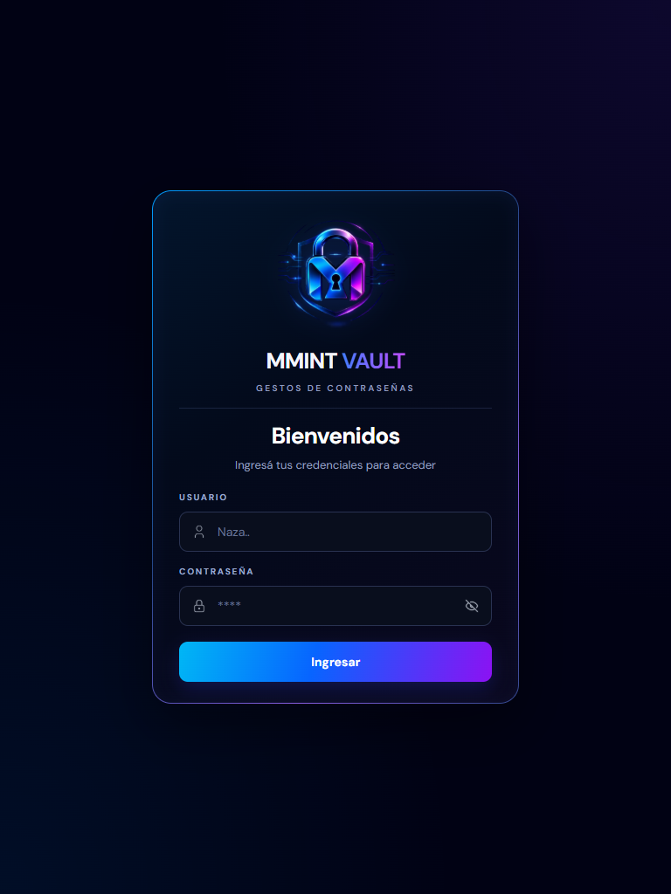
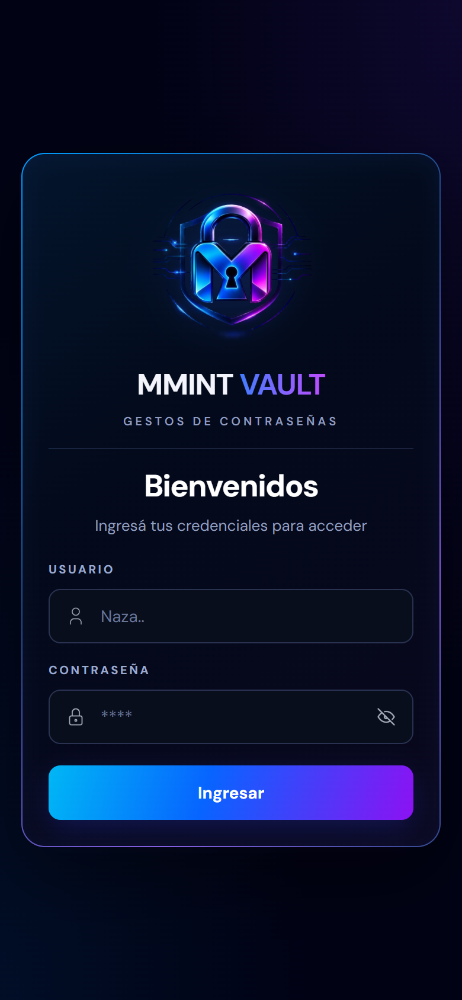
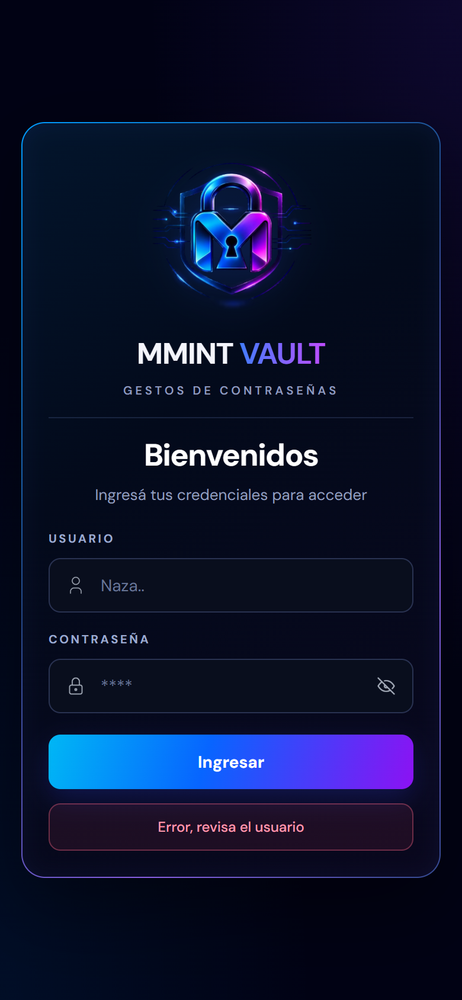

# MMINT Vault · Login

Pantalla de acceso de **MMINT Vault**, el gestor de contraseñas del equipo de MMINT. Hecha con **React 19** y **Vite**, con un diseño oscuro de acentos azul y violeta, adaptada a computadora, tablet y celular.

Por ahora es solo la pantalla: no hay backend ni autenticación real (ver [Estado del proyecto](#estado-del-proyecto)).


## Qué incluye

- **Formulario de acceso** con usuario y contraseña, y un botón para **mostrar u ocultar la contraseña**.
- **Validación de campos**: revisa primero el usuario y después la contraseña. Si alguno está vacío, aparece un mensaje de error debajo del botón **Ingresar**.
- **Portada de marca** a la izquierda: titular, bajada y copyright sobre una imagen de fondo.
- **Tarjeta de login** con el logo de MMINT Vault.
- **Responsive**, con la portada oculta en pantallas chicas (ver más abajo).
- **Movimiento reducido**: se quitan las transiciones de campos y botones si la persona lo pide en su sistema.

## Capturas

### Tablet

En pantallas de hasta 900 px se oculta la portada y el formulario queda solo, centrado.



### Celular



### Validación

Si un campo está vacío, el error aparece debajo del botón.



## Cómo correrlo

Necesitás [Node.js](https://nodejs.org) (se probó con la versión 24) y [pnpm](https://pnpm.io).

```bash
pnpm install
pnpm dev
```

Se abre en `http://localhost:5173`.

| Comando | Qué hace |
|---|---|
| `pnpm dev` | Servidor de desarrollo con recarga automática |
| `pnpm build` | Genera la versión de producción en `dist/` |
| `pnpm preview` | Sirve localmente la versión de producción |
| `pnpm lint` | Revisa el código con ESLint |

## Estructura

```
src/
├── main.jsx                      # Punto de entrada
├── LoginApp.jsx                  # Arma las dos mitades de la pantalla
├── components/
│   ├── LadoIzquierdo.jsx         # Portada: titular, bajada y copyright
│   └── LadoDerecho.jsx           # Logo, formulario y validación
├── imgs/                         # Logo, fondo e íconos
├── styles/
│   ├── style_loginizquierdo.css  # Layout general y portada
│   └── styles_loginderecho.css   # Tarjeta y formulario
└── assets/                       # Archivos de la plantilla de Vite
docs/                             # Capturas de este README
```

## Diseño

### Colores

| Nombre | Valor | Uso |
|---|---|---|
| Noche | `#010214` | Fondo general |
| Tarjeta | `#03152C` → `#030A1B` → `#09071D` | Degradé de la tarjeta de login |
| Campo | `#090E1D` | Relleno de los campos |
| Botón | `#00B7F5` → `#0765FF` → `#8C12F3` | Degradé del botón **Ingresar** |
| Marca | `#427DFF` → `#C04CFF` | Degradé de la palabra **VAULT** |
| Blanco | `#F5F6FF` | Texto principal |
| Gris | `#9DAACE` | Textos secundarios |
| Rosa | `#FF9AAF` | Mensaje de error |

### Tipografía

[**DM Sans**](https://fonts.google.com/specimen/DM+Sans) para textos, etiquetas y botones, y [**Fredoka**](https://fonts.google.com/specimen/Fredoka) para el titular de la portada. Se cargan desde Google Fonts en `style_loginizquierdo.css`.

### Responsive

| Ancho de pantalla | Qué pasa |
|---|---|
| **Más de 900 px** | Dos mitades: la portada a la izquierda y el formulario a la derecha. |
| **900 px o menos** | Se oculta la portada y queda solo el formulario. |
| **550 px o menos** | Tarjeta con menos relleno, para aprovechar el ancho del celular. |

## Estado del proyecto

Es la **pantalla de acceso (front)**. Todavía falta:

- **Conectar la autenticación.** Hoy el formulario solo valida que los campos no estén vacíos; no hay llamada a un servidor ni sesión.
- **Mensajes de error más específicos** (usuario o contraseña incorrectos) cuando exista el backend.

Lo que menciona la portada (cifrado AES-256, verificación en dos pasos y control de acceso por usuario) describe el producto: nada de eso está implementado en este repositorio.

## Tecnologías

- [React](https://react.dev) 19
- [Vite](https://vite.dev) 8
- CSS puro, sin librerías de estilos
- [ESLint](https://eslint.org)

---

© 2026 MMINT · Mercado Inteligente
